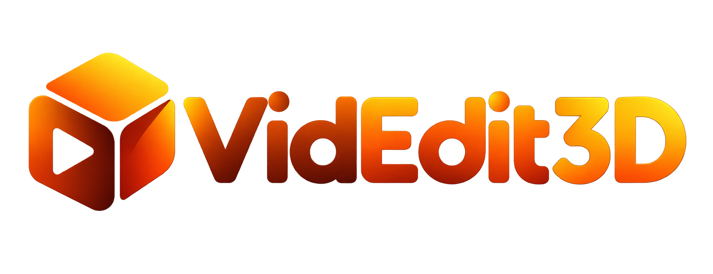
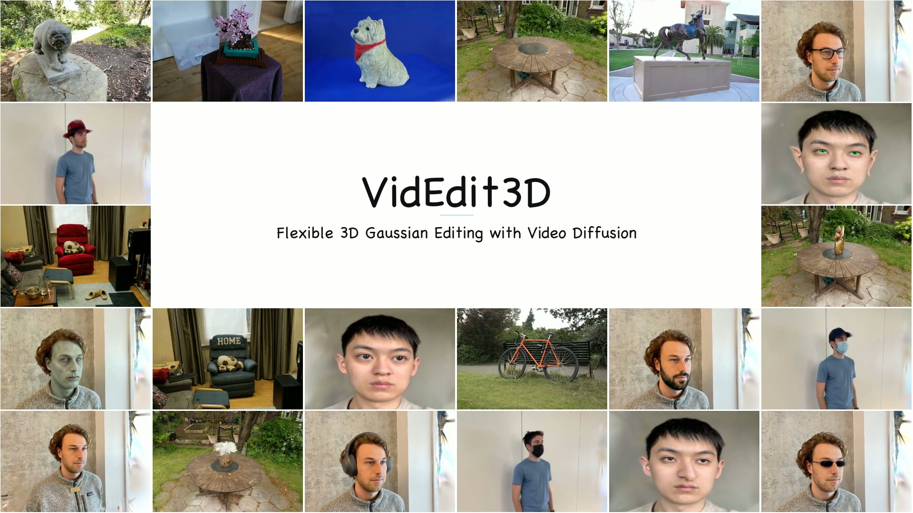

<p align="center">
  
</p>

<h1 align="center">VidEdit3D: Flexible 3D Gaussian Editing with Video Diffusion</h1>

<p align="center">
  <a href="https://2hitee.github.io/">Yanming Yang</a><sup>1</sup> ·
  <a href="http://chenxi-song.github.io/">Chenxi Song</a><sup>1</sup> ·
  <a href="http://tongzhao1030.github.io/">Tong Zhao</a><sup>1</sup> ·
  <a href="https://openreview.net/profile?id=~Juntao_Xu1">Juntao Xu</a><sup>1</sup><br>
  <a href="https://openreview.net/profile?id=~Wenhao_Rao1">Wenhao Rao</a><sup>2</sup> ·
  <a href="https://buaacyw.github.io/">Yiwen Chen</a><sup>3</sup> ·
  <a href="https://wangywust.github.io/">Yiwei Wang</a><sup>4</sup> ·
  <a href="https://icoz69.github.io/">Chi Zhang</a><sup>1,†</sup>
</p>

<p align="center">
  <sup>1</sup> Westlake University · <sup>2</sup> University of Leeds<br>
  <sup>3</sup> Nanyang Technological University · <sup>4</sup> University of California, Merced<br>
  <sub>† Corresponding author</sub>
</p>

<p align="center">
  <a href="https://arxiv.org/abs/2610.35756"></a>
  <a href="https://2hitee.github.io/VidEdit3D-page/#demo"></a>
  <a href="https://2hitee.github.io/VidEdit3D-page/"></a>
  <a href="https://arxiv.org/pdf/2610.35756"></a>
</p>

<p align="center">
  <a href="https://2hitee.github.io/VidEdit3D-page/#demo"></a>
</p>

## 🔍 Overview

**VidEdit3D** edits a 3D Gaussian scene from a single edited anchor view. It
renders camera trajectories from the source scene, propagates the edit with a
pretrained Wan2.1 image-to-video model, and transfers the video guidance back to
the 3D representation. It supports creative and local changes, object additions,
and deletions.

| Component | Role |
| --- | --- |
| TGR | Selects views from the user anchor with FPS and source-subject semantics, then connects them with a closed KB spline. |
| FAVE | Propagates edits through three-branch denoising and First-Frame-Sink attention. |
| RS-GS | Transfers edited frames to the Gaussian scene with mask-guided updates that preserve unedited content. |

FAVE builds on the official `diffusers==0.34.0` Wan backbone, VAE, schedulers,
and pipeline components.

## 🚀 Code

**Code will be released soon.**

## 📖 Citation

If you use VidEdit3D in your research, please cite the accompanying paper:

```bibtex
@misc{yang2026videdit3dflexible3dgaussian,
  title={VidEdit3D: Flexible 3D Gaussian Editing with Video Diffusion},
  author={Yanming Yang and Chenxi Song and Tong Zhao and Juntao Xu and Wenhao Rao and Yiwen Chen and Yiwei Wang and Chi Zhang},
  year={2026},
  eprint={2610.35756},
  archivePrefix={arXiv},
  primaryClass={cs.CV},
  url={https://arxiv.org/abs/2610.35756},
}
```

## 🙏 Acknowledgements

VidEdit3D builds on [Nerfstudio](https://github.com/nerfstudio-project/nerfstudio),
[Diffusers](https://github.com/huggingface/diffusers),
[Wan2.1](https://github.com/Wan-Video/Wan2.1),
and [GaussCtrl](https://github.com/ActiveVisionLab/gaussctrl). We thank the authors
and maintainers of these projects.

## 📄 License

Original code will be released under Apache-2.0. Portions adapted from GaussCtrl remain
under BSD-3-Clause, and bundled upstream code keeps its original license. See
[LICENSE](LICENSE), [LICENSES](LICENSES), and
[THIRD_PARTY_NOTICES](THIRD_PARTY_NOTICES) for details. Downloaded model assets
remain governed by their upstream licenses and terms.

## ✉️ Contact

[Yanming Yang](https://2hitee.github.io/) —
[yangyanming@westlake.edu.cn](mailto:yangyanming@westlake.edu.cn)
